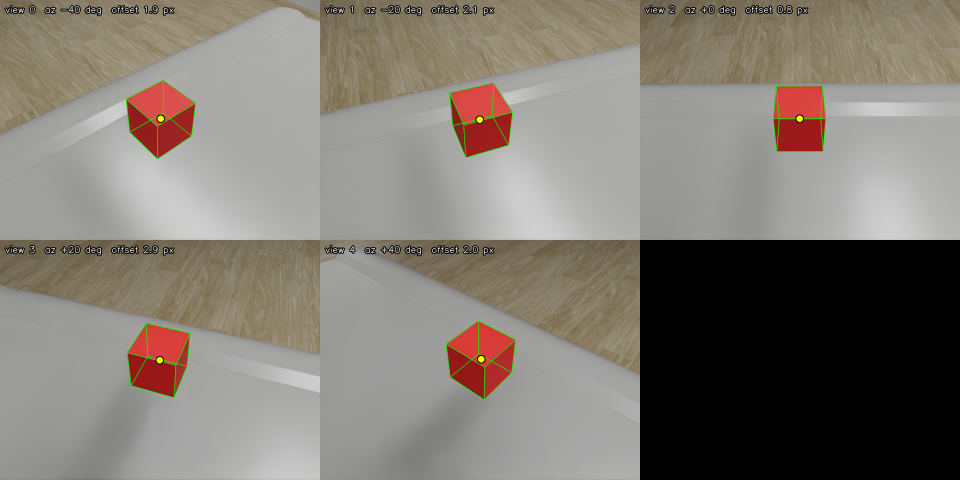

# UR5e Isaac Sim demo

ROS 2 Jazzy workspace that launches a UR5e into NVIDIA Isaac Sim and brings up MoveIt against the simulator's ROS 2 bridge.

Isaac Sim is expected at `~/isaacsim` (this setup was run with Isaac Sim 6.0). The ROS side uses the official Universal Robots description and MoveIt config. Joint commands and joint states cross the bridge on `/isaac_joint_commands` and `/isaac_joint_states`, with simulation time on `/clock`.

## Packages

| Package | Role |
|---|---|
| `ur_description` | Official URDF, meshes, and kinematics from [Universal_Robots_ROS2_Description](https://github.com/UniversalRobots/Universal_Robots_ROS2_Description), branch `jazzy`. |
| `ur_moveit_config` | Official MoveIt config. `Universal_Robots_ROS2_MoveIt_Config` is no longer a separate repository; the package lives in [Universal_Robots_ROS2_Driver](https://github.com/UniversalRobots/Universal_Robots_ROS2_Driver), branch `jazzy`. This workspace keeps a sparse checkout of `ur_moveit_config` only. |
| `topic_based_ros2_control` | ros2_control hardware interface from [PickNikRobotics/topic_based_ros2_control](https://github.com/PickNikRobotics/topic_based_ros2_control). It publishes joint commands and subscribes to joint states so MoveIt can drive the simulated arm. |
| `ur5e_isaac_bridge` | Launch package for this demo. It imports the UR5e URDF into Isaac Sim, creates the ROS 2 bridge action graph, and starts `ros2_control` and MoveIt after `/clock` and `/isaac_joint_states` are publishing. |

Upstream pins are listed in `ros2_ws/ur5e_isaac.repos`.

## Data center assets

The Data Hall asset stage and its components are in NVIDIA's Data Center Assets Pack.

1. Open the [Data Center Assets Pack](https://docs.omniverse.nvidia.com/usd/latest/usd_content_samples/downloadable_packs.html#data-center-assets-pack) section of the Omniverse downloadable packs page.
2. Click **Download the Data Center Assets Pack**.

That downloads a ZIP of the USD assets, including the Data Hall stage and components. The pack is about 9.8 GB.

Unzip the pack and open `Stages/Data_Hall/DataHall_Full_B01.usd`. That is the stage to use. It contains the data hall, the rack row, and the equipment placed in those racks. Physics and collision are not authored on this stage, so nothing in it collides until you add colliders yourself.

Each rack has a `Front_Door` that is invisible by default. The door mesh is authored with zero opacity, and on some racks the prim visibility is set to invisible as well. The door is still in the stage. If you enable collision on the racks, that hidden door can become a collider and block the arm even though you cannot see it.

Deactivate every `Front_Door` before you add collision, so the door is not part of the stage:

1. In Isaac Sim, open `DataHall_Full_B01.usd`.
2. In the Stage panel, search for `Front_Door`.
3. There is one under each rack, at `/World/DataHall_01/DataHall_01/DataHall_Racks/Rack_42U_0N/Rack_42U_01/Front_Door` (`N` is 1 through 5). Select the `Front_Door` xform, not only a child such as `Front_Door_Frame`.
4. Right-click it and choose **Deactivate**.

A deactivated prim is dropped from the composed stage, so it is neither drawn nor given a collider later. Hiding it with the eye icon only changes visibility. Do that deactivate step first, then add collision to the hall.

## Build

```bash
cd ros2_ws
source /opt/ros/jazzy/setup.bash
colcon build --symlink-install --cmake-args -DBUILD_TESTING=OFF
source install/setup.bash
```

`topic_based_ros2_control` configures tests that need `ros-jazzy-ros-testing`. The `-DBUILD_TESTING=OFF` argument skips those test-only dependencies.

## Launch

```bash
cd ros2_ws
source /opt/ros/jazzy/setup.bash
source install/setup.bash
ros2 launch ur5e_isaac_bridge ur5e_isaac.launch.py
```

The launch file starts Isaac Sim with `~/isaacsim/python.sh`, imports the UR5e, and presses Play inside the standalone script. MoveIt and RViz start after the bridge topics appear. In RViz, plan with the `ur_manipulator` group.

Useful arguments:

| Argument | Default | Meaning |
|---|---|---|
| `ur_type` | `ur5e` | Robot model passed to the Universal Robots description. |
| `launch_isaac` | `true` | Start Isaac Sim from this launch. Set `false` to attach MoveIt to a simulator that is already running. |
| `launch_rviz` | `true` | Start RViz with the official MoveIt display config. |
| `use_sim_time` | `true` | Use `/clock` from Isaac Sim. |
| `headless` | `false` | Run the Isaac Sim app without a window. |
| `isaac_python` | `~/isaacsim/python.sh` | Isaac Sim Python launcher. |
| `joint_commands_topic` | `/isaac_joint_commands` | Commands from ros2_control into Isaac Sim. |
| `joint_states_topic` | `/isaac_joint_states` | Joint states from Isaac Sim into ros2_control. |

The first Isaac Sim startup can take longer than the launch's 180 second wait. If the log reports that the bridge timed out and MoveIt was not launched, leave the simulator running and start MoveIt against it:

```bash
ros2 launch ur5e_isaac_bridge ur5e_isaac.launch.py launch_isaac:=false
```

The ROS terminal and Isaac Sim need the same `ROS_DOMAIN_ID`. The bridge graph uses the domain from that environment variable.

On this machine Isaac Sim is installed as a pip package in a virtual environment rather than at `~/isaacsim`, so the launch is pointed at its Python:

```bash
ros2 launch ur5e_isaac_bridge ur5e_isaac.launch.py \
  isaac_python:=$HOME/robotics/IsaacSim/.venv/bin/python
```

## Problem 1: wrist camera

The arm carries an eye-in-hand RGB camera on `tool0`. It publishes over the same ROS 2 bridge graph (`/ActionGraph`) as the joint topics.

| Topic | Type | Notes |
|---|---|---|
| `/wrist_cam/image_raw` | `sensor_msgs/Image` | `rgb8`, 640 x 480, 15 Hz |
| `/wrist_cam/camera_info` | `sensor_msgs/CameraInfo` | Pinhole, 60 degree horizontal FOV, fx = fy = 554.26, cx = 320, cy = 240, zero distortion |
| `/wrist_cam/depth/image_raw` | `sensor_msgs/Image` | Bonus. `32FC1`, metres along the optical axis |

All three carry simulation time stamps and `frame_id: camera_optical_frame`.

### How it fits together

```
ur_isaac.urdf.xacro                      spawn_ur5e.py (Isaac Sim)
  tool0                                    URDF importer creates one prim per link
   └ tool0_camera_joint (fixed)              .../tool0/camera_link/camera_optical_frame
      camera_link      X fwd, Y left, Z up     └ WristCamera  (UsdGeom.Camera, rotateX 180)
       └ camera_optical_joint (fixed)       /ActionGraph
          camera_optical_frame Z fwd,         OnPlaybackTick -> IsaacCreateRenderProduct
                               X right,         -> ROS2CameraHelper (rgb)    /wrist_cam/image_raw
                               Y down           -> ROS2CameraHelper (depth)  /wrist_cam/depth/image_raw
                                                -> ROS2CameraInfoHelper      /wrist_cam/camera_info
robot_state_publisher -> /tf, /tf_static
```

### Design choices

- **The xacro is the only place the camera pose is defined.** `robot_state_publisher` publishes `tool0 -> camera_link -> camera_optical_frame` to TF. Isaac Sim imports the same URDF, and `spawn_ur5e.py` creates the USD camera as a child of the imported `camera_optical_frame` prim. TF and the rendered image therefore cannot disagree, and Isaac does not publish any TF of its own (which would duplicate frames).
- **Optical frame rotation.** `camera_link` follows REP 103 for a body (X forward, Y left, Z up). `camera_optical_frame` follows REP 103 for images (Z forward, X right, Y down), which is `rpy = (-90 deg, 0, -90 deg)` from `camera_link`.
- **USD vs ROS camera axes.** A USD camera looks along its local -Z with +Y up. A ROS optical frame looks along +Z with +Y down. The two differ by a 180 degree rotation about X, so that is the only transform on the `WristCamera` prim.
- **Mount.** `camera_xyz = "0 0.06 0.02"`, `camera_rpy = "-90deg -90deg 0"` (xacro arguments). The camera looks along `tool0` +Z, 6 cm off the tool axis and 2 cm in front of the flange, with image-up along `tool0` -Y. That keeps the image upright when the arm reaches forward and looks down with `wrist_3` at zero, and leaves the tool axis free for a gripper.
- **Camera body.** `camera_link` has a 25 x 90 x 25 mm box as visual and collision geometry and a 72 g inertia. MoveIt keeps the camera out of collisions as part of the wrist. The inertia stops Isaac Sim warning about a massless rigid body.
- **Intrinsics.** Square pixels. Horizontal aperture 20.955 mm, vertical aperture scaled by 480/640, focal length from a 60 degree horizontal FOV. `camera_info` is derived by Isaac from those USD attributes.
- **Near clip.** Set to 1 cm. The USD default is 1 stage unit (1 m here), which would clip everything a wrist camera looks at.
- **Rate.** 15 Hz comes from `omni:sensor:tickRate` on the camera prim (`RtxCamera(tick_rate=...)`). `frameSkipCount` is deprecated for this in Isaac Sim 6.x.

Resolution, FOV, rate and namespace are arguments of `spawn_ur5e.py` (`--camera-width`, `--camera-height`, `--camera-hfov-deg`, `--camera-rate`, `--camera-namespace`).

### Checking it

```bash
ros2 topic hz /wrist_cam/image_raw                  # about 15 Hz in sim time
ros2 topic echo /wrist_cam/camera_info --once
ros2 run tf2_ros tf2_echo base_link camera_optical_frame   # changes as the arm moves
ros2 run rqt_image_view rqt_image_view /wrist_cam/image_raw
```

In RViz, add a **Camera** display on `/wrist_cam/image_raw`. It draws the robot model and planning scene over the image from the camera's TF pose, so a wrong frame shows up as a misaligned overlay.

## Problem 2: capture and verify

### Target cube

`spawn_ur5e.py` adds a visual-only, bright red cube, **5 cm edge, centred at (0.50, 0.00, 0.20) m in `base_link`** (`world` and `base_link` coincide in this URDF). It has no collider, so physics ignores it. Change it with `--cube-xyz` and `--cube-size`, or leave it out with `--no-cube`.

### Capture

With the simulator and MoveIt running:

```bash
cd ros2_ws/src/ur5e_isaac_bridge/scripts
python3 capture_views.py --out ../../../../captures
```

`capture_views.py`:

1. Adds the cube to the MoveIt planning scene as a collision box, because MoveIt cannot see Isaac's stage, then moves to a ready pose above the workspace (elbow up, camera looking down).
2. Computes 5 camera poses on an arc around the cube: 0.30 m from its centre, 45 degree elevation, azimuth -40 to +40 degrees in 20 degree steps, on the robot side of the cube. Each pose aims optical +Z at the cube centre with the horizon level.
3. Converts each camera pose to a `tool0` pose with the fixed `tool0 -> camera_optical_frame` transform from TF, and solves IK with MoveIt `/compute_ik`. Every solve is seeded from the previous solution so the arm stays on one IK branch.
4. Plans and executes the joint goal through the MoveGroup action (`/move_action`), replanning up to 3 times if MoveIt rejects a plan.
5. Waits until the arm is still: no joint moved more than 5e-4 rad over the last 0.5 s of sim time.
6. Takes the first image stamped after that settle time, so the frame cannot be from before or during the motion.
7. Looks up TF `base_link -> camera_optical_frame` **at that image's stamp**, and saves it with the joint angles.

Output:

| File | Content |
|---|---|
| `captures/images/view_XX.png` | The 5 RGB images |
| `captures/depth/view_XX.npy`, `.png` | Bonus depth, metres (`.npy`) and a colour preview |
| `captures/poses.jsonl` | One line per image: stamp, joint names and angles, camera pose (translation, quaternion xyzw) `base_link -> camera_optical_frame`, cube position |
| `captures/camera_info.yaml` | Intrinsics in the ROS `camera_calibration` format |

### Projection check

```bash
python3 verify_projection.py --dir ../../../../captures
```

Uses only `poses.jsonl` and `camera_info.yaml` (no ROS). For each image it transforms the cube centre into the camera frame with the inverse of the saved pose, projects it with `u = fx x/z + cx`, `v = fy y/z + cy`, and draws:

- a **yellow dot** at the projected cube centre,
- **green lines** for the 12 projected cube edges,
- a **cyan cross** at the centroid of the red pixels found in the image.

It also reports the pixel distance between the projected centre and the red centroid, and the difference between the depth image and a ray-cast against the cube at the projected pixel. Results go to `captures/overlays/view_XX.png`, `captures/overlays/contact_sheet.png` and `captures/report.json`.

### Results

The captured set is committed in `captures/`. It was recorded with the Isaac Sim GUI running. Screen recordings of that run (about 1 minute each) and the Problem 1 topic checks are in [`evidence/`](evidence/README.md).



| View | Azimuth (deg) | Projected cube centre (px) | Offset to red centroid (px) | Depth error at that pixel (mm) |
|---|---|---|---|---|
| 0 | -40 | (320.7, 237.0) | 1.9 | -0.4 |
| 1 | -20 | (319.4, 239.0) | 2.1 | -0.3 |
| 2 | +0 | (319.0, 237.2) | 0.8 | +0.2 |
| 3 | +20 | (319.4, 239.7) | 2.9 | -0.4 |
| 4 | +40 | (322.0, 238.4) | 2.0 | -0.1 |

Every projected point lands on the cube, and the projected wireframe lies on the rendered cube edges. The camera reached each requested pose to within 2 mm. The remaining 1 to 3 px offset is expected: the centroid of the visible red faces is not the projection of the cube centre under perspective.

### What the check caught

The first full run put the dot on the cube, but every view had the projected wireframe about 17 px above the rendered cube and the depth image read 20 mm too far. Back-projecting the red pixels with the depth image showed the cube in the right place in X and Y but 1.4 cm low in Z, by the same amount in all five views. A camera-mount or intrinsics error would vary with the arm configuration, so this pointed at the whole robot being offset. Reading the live prim poses in Isaac confirmed it: `base_link_inertia` sat at z = +1.47 cm. Two fixes in `spawn_ur5e.py`:

- **Base pushed up by the table.** The base is held by a plain fixed joint, not as part of the articulation, so contact can move it, and the UR base collision mesh overlaps the Simple Room table. `bolt_base_to_environment()` filters contacts between the base and the room colliders (a real arm is bolted to its table). The other links still collide with the room. With the room removed the base sat at exactly z = 0, which confirmed the cause.
- **Arm spawned inside the table.** With the base back at z = 0, the importer's all-zero joint pose put the wrist inside the table before ros2_control could lift the arm, and PhysX pushed it underneath. MoveIt then refused to plan because the start state was in collision. `set_initial_joint_positions()` sets the joint state and drive targets from `ur_description/config/initial_positions.yaml` (the same file ros2_control uses) before Play.

After both fixes the offset dropped from 17 px to under 3 px and the depth error from 20 mm to under 0.5 mm.

## Known issues

- **Isaac Sim version.** Developed and tested on Isaac Sim 6.1.0-rc.26 installed with pip, not 6.0 at `~/isaacsim`. The launch needs `isaac_python:=` pointing at that install (see above). The OmniGraph node names used are the same as in the 6.0 ROS 2 camera tutorial.
- **Joint velocities from the bridge are noise.** With the arm stationary, `/isaac_joint_states` reports velocities up to about 3 rad/s while positions do not change. The settle check therefore uses joint positions, not a velocity threshold.
- **Joint positions are published rounded to 1e-4 rad.** At rest a joint can flicker by one step, so the settle tolerance is 5e-4 rad.
- **The first plan from the launch pose can clip the cube.** OMPL checks collisions between states at a finite resolution, so a path can graze the cube; MoveIt's `ValidateSolution` rejects it (`INVALID_MOTION_PLAN`). The capture script goes to a ready pose first and replans on failure.
- **IK wrist configurations.** Each view is seeded from the previous IK solution, but the camera is mounted off the tool axis, so `wrist_3` winds up to about -5 rad across the arc. It is within the UR joint limits.
- **Image rate in wall time.** The camera ticks at 15 Hz of sim time. With the GUI and path tracing on a laptop GPU, the simulator runs slower than real time, so `ros2 topic hz` in wall time can read below 15.
- **The red-centroid offset is not zero by construction.** The centroid of the visible red faces is not the projection of the cube centre under perspective (the top face and the side faces are seen at different depths), so a few pixels of offset is expected. A wrong frame rotation shows up as tens to hundreds of pixels, or the dot on the wrong side of the image.
- **RViz `/recognize_objects not available` error** at startup is harmless. That MoveIt panel feature is not used.
- **Dragging the goal in RViz does not move the robot** until **Plan & Execute** is pressed. Only the orange goal preview moves.

## AI tools used

I used Claude (Anthropic) through Claude Code as a coding assistant.
